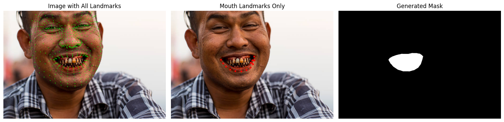
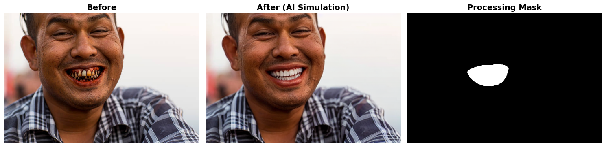

# AI Dental Smile Simulation Pipeline

Complete Image-to-Image Workflow for Dental Consultation Previews using Stable Diffusion Inpainting, MediaPipe for automatic mouth detection, and OpenCV for mask generation.

## 🦷 Features

- **Automatic Mouth Detection**: Uses MediaPipe Face Landmarker to detect facial landmarks and create precise mouth masks
- **Realistic Dental Simulations**: Leverages Stable Diffusion XL Inpainting for high-quality results
- **Multiple Treatment Options**: Whitening, straightening, veneers, and comprehensive treatments
- **Before/After Visualization**: Side-by-side comparison of original and simulated images
- **Google Colab Compatible**: Works on free tier with GPU acceleration
- **Local Execution Support**: Runs on local machines with or without GPU

## 🛠️ Technical Stack

- **AI Model**: Stable Diffusion XL 1.0 Inpainting (diffusers/stable-diffusion-xl-1.0-inpainting-0.1)
- **Face Detection**: MediaPipe Face Landmarker
- **Computer Vision**: OpenCV for image processing
- **Framework**: PyTorch, Hugging Face Diffusers
- **Visualization**: Matplotlib for before/after comparisons

## 📋 Prerequisites

- Python 3.8+
- PyTorch
- Hugging Face Diffusers
- MediaPipe
- OpenCV
- NumPy
- Pillow
- Matplotlib

## 🔧 Installation

1. Clone the repository:

   ```bash
   git clone <repository-url>
   cd dencalc-ai
   ```

2. Create a virtual environment:

   ```bash
   python -m venv .venv
   source .venv/bin/activate  # On Windows: .venv\Scripts\activate
   ```

3. Install dependencies:

   ```bash
   pip install torch torchvision --index-url https://download.pytorch.org/whl/cpu
   pip install diffusers transformers accelerate mediapipe opencv-python pillow matplotlib torch torchvision
   ```

4. Download the MediaPipe face landmarker model:

    The notebook will automatically download the model on first run.

## 🚀 Usage

### Jupyter Notebook Execution

1. Launch Jupyter:

```bash
jupyter notebook
```

1. Open `dental-smile-ai.ipynb`

2. Run all cells in sequence:

   - Environment setup and installation

   - Device detection (CPU/GPU)

   - Model loading

   - Mouth detection initialization

   - Dental simulator setup

   - Image processing functions

   - Upload and process your image

   - Generate simulations

   - View results

### Input Requirements

- High-resolution portrait photos with clear visibility of teeth
- Good lighting conditions
- Front-facing or slightly angled shots work best
- Avoid extreme angles or obscured mouth regions

## ⚙️ Configuration Options

### Treatment Types Available

- `whitening`: Perfect white teeth, bright smile
- `straightening`: Perfectly straight aligned teeth
- `veneers`: Perfect porcelain veneers, Hollywood smile
- `comprehensive`: Perfect white straight teeth, beautiful smile

### Parameter Tuning

- `strength`: Controls the intensity of changes (0.6-0.8 for subtle, 0.8-1.0 for dramatic)
- `guidance_scale`: Affects adherence to the prompt (7.5-10 for balanced results)
- `num_inference_steps`: Quality vs speed trade-off (20-30 recommended)

## 🏗️ Architecture

The pipeline consists of four main components:

1. **Stable Diffusion Inpainting Model**: Generates realistic dental improvements within the detected mouth region
2. **MediaPipe Face Landmarker**: Detects facial landmarks and identifies mouth region
3. **Mask Generation System**: Creates precise masks for inpainting based on detected landmarks
   
4. **Dental Simulator Class**: Orchestrates the entire process with treatment-specific prompts
   

## 📊 Performance Tips

### Memory Management

- Use `pipe.enable_attention_slicing()` for lower memory usage
- Use `pipe.enable_model_cpu_offload()` to move models between CPU/GPU
- Process images at 512x512 resolution for faster inference

### Parameter Tuning for Realism

- `strength`: 0.6-0.8 for subtle changes, 0.8-1.0 for dramatic changes
- `guidance_scale`: 7.5-10 for balanced results
- `num_inference_steps`: 20-30 for good quality/speed balance

### Common Issues & Solutions

- **No face detected**: Ensure good lighting and clear face visibility
- **Unnatural results**: Lower strength parameter, improve negative prompts
- **Memory errors**: Enable attention slicing and model offloading
- **Slow processing**: Reduce image size or inference steps

## 🌐 Production Deployment

The notebook includes conceptual implementations for production deployment:

- **FastAPI Service**: REST API for dental simulation requests
- **Node.js Backend**: Integration with existing systems
- **S3 Storage**: Cloud storage for results
- **Docker Deployment**: Containerized solution
- **ComfyUI Alternative**: Visual workflow editor

## 🎯 Use Cases

- **Dental Consultations**: Preview potential treatment outcomes
- **Patient Education**: Visualize different treatment options
- **Treatment Planning**: Compare different approaches
- **Marketing Materials**: Showcase potential results
- **Training**: Educational purposes for dental professionals

## 🤝 Contributing

1. Fork the repository
2. Create a feature branch
3. Make your changes
4. Add tests if applicable
5. Submit a pull request

## 📄 License

This project is licensed under the MIT License - see the LICENSE file for details.

## 🆘 Support

For issues and questions, please create an issue in the GitHub repository.

## 🙏 Acknowledgments

- Stable Diffusion models from Hugging Face Diffusers
- MediaPipe for face landmark detection
- OpenCV for computer vision operations
- The open-source community for the underlying technologies
